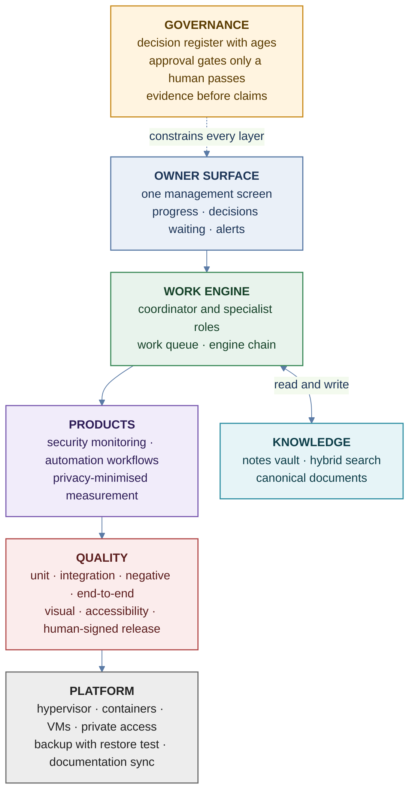

# enterprise-infrastructure-lab

> Infrastructure patterns, quality gates and an AI-agent operating model for a small engineering lab, documented the way they would be run in production.

## What it does and what it makes easier

- Turns 'how should this be run?' into short, reviewable documents: principles, a reference design, and how to prove it works.
- Makes reviews, audits and hand-overs easier, because every topic states its decisions, trade-offs and checks in one place.
- Shows how the layers of a modern stack fit together: platform, knowledge, agents, products, quality and governance.

## Architecture at a glance

The layers, from governance down to the platform. Topology, data flows and the host are drawn in docs/topology.md.

## Documents

| Area | Document | Status |
|---|---|---|
| Whole stack, hardware to services | docs/end-to-end-architecture.md | in use |
| Topology diagrams and layers (host, containers, VMs, app and service layers) | docs/topology.md | in use |
| Layered architecture and decisions | docs/architecture.md | in use |
| Administrative access model | docs/access-model.md | in use |
| Documentation as code | docs/documentation-sync.md | in use |
| Network segmentation and firewalling | docs/network-segmentation.md | reference pattern |
| Backup and recovery | docs/backup-recovery.md | reference pattern |
| Quality engineering (QA, E2E, release gates) | docs/quality-engineering.md | in use |
| Runnable examples: restore test, docs sync, access, Ansible, Terraform | examples/ | restore test runs and is tested; others checked, see examples/README.md |
| Product measurement with privacy by design | docs/measurement-and-privacy.md | reference pattern; implemented and tested, production rollout pending |
| Agent engine design | docs/agent-engine.md | in use |
| Personal knowledge system | docs/second-brain-knowledge-system.md | in use |
| Architecture decision records | docs/adr/ | in use |

Status: 'in use' means practiced in the lab. 'Reference pattern' means a design written for production-style use; where code exists, the status line says how far it has been rolled out.

## Principles

1. One source of truth, linked rather than copied.
2. Deterministic where it matters; models where judgement helps.
3. Evidence before claims; humans for gates.
4. Least privilege for every key, account and agent.
5. Narrow interfaces between layers, so each can be replaced.

## How to read this repository

Start with the end-to-end architecture, then read the topic that matches your question. Each document is short on purpose and ends with how to check it works.

## Sanitization

All host names, addresses and identifiers are removed or replaced. Example addresses use the documentation ranges in RFC 5737 (192.0.2.0/24, 198.51.100.0/24, 203.0.113.0/24).

## License

MIT. See LICENSE.
