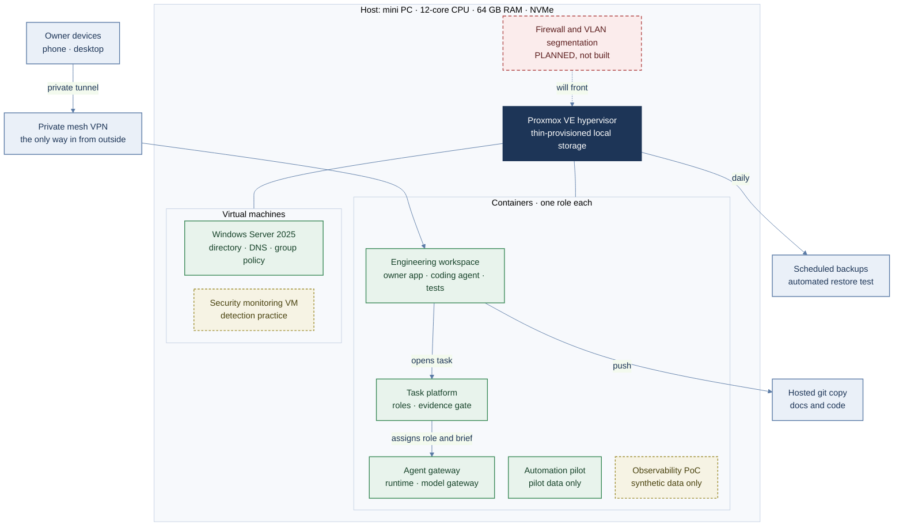
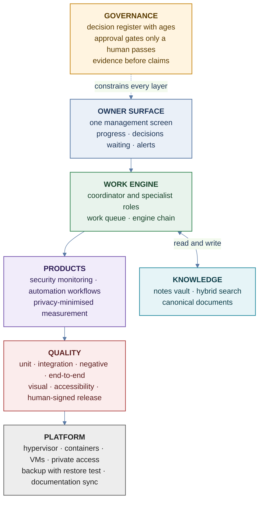
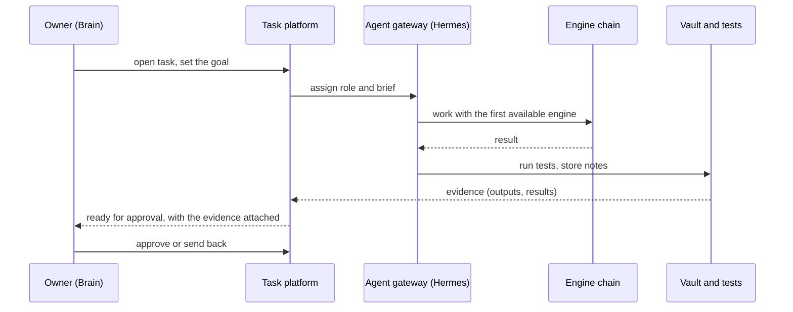
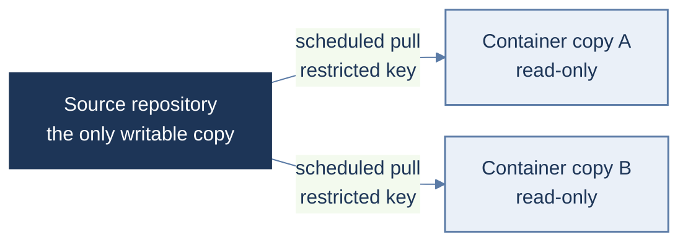
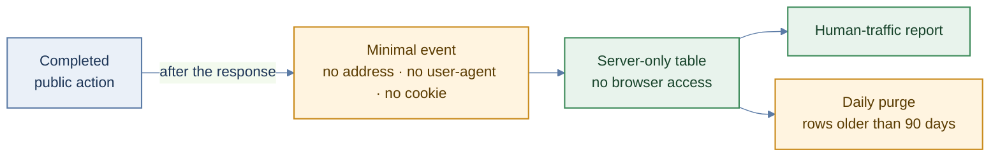

# Topology and layers

How the lab fits together, drawn from the machine up to the screen I use. Addresses, host names, ports and credentials are left out on purpose. Status was checked on the hypervisor on the day of writing; things that are not built yet are marked **planned**.

## 1. Platform topology

Legend: green = in use · dashed yellow = built, powered off when idle · dashed red = planned, not built · dark = hypervisor.

Why this shape: a hypervisor on one low-power machine gives me containers for quick, cheap Linux workloads and a real virtual machine where I need a separate kernel (Windows Server). Each container has one job, so a fault in one does not share files or processes with another.

## 2. Layer model

| Layer | What lives here | Notes |
|---|---|---|
| Owner surface | **Brain**: one installable web app (phone and desktop) for progress, decisions, approvals | Opened over the private mesh VPN; the task platform behind it is not what I work in |
| Application layer | Brain, the products (a security monitoring product, workflow automations, a desktop app), the coding agent | Built and tested in the engineering workspace |
| Service layer | Task platform, agent gateway (**Hermes Agent**), model gateway, automation engine | Roles, an evidence gate and a chain of engines; the engine that builds a task never audits it |
| Knowledge layer | **Obsidian** notes vault (decisions, learnings, project context), hybrid keyword and meaning search, decision register | Synchronized between the workstation and the containers with versions kept; no secrets stored |
| Identity and directory | Windows Server VM: directory, DNS, group policy | Practice environment for server and access administration |
| Platform layer | Proxmox VE, thin storage, backups, documentation sync | One writable copy of the documentation; containers pull read-only copies on a schedule |
| Hardware | The host machine | Chosen for cost, noise and power draw |

## 3. What happens when I give a task

If an engine reaches its limit, the next one in the chain takes over. A task cannot be closed without evidence, and only I can approve the gates that matter (release, outward messages).

## 4. Status of the parts

| Part | Status |
|---|---|
| Hypervisor, containers, backups, documentation sync | In use |
| Brain (owner surface) | In use |
| Agent gateway and task platform | In use |
| Automation pilot | In use, on pilot data |
| Windows Server VM | In use as a practice environment |
| Observability proof of concept | Built, powered off when idle |
| Security monitoring VM | Built, powered off when idle |
| Firewall and VLAN segmentation | **Planned**, not built |

## 5. Data flows

Three flows that make the platform trustworthy. Each is one direction, narrow and checkable.

### Documentation: one writable copy

### Product measurement: minimal events, short retention

Backups follow the same idea: a daily off-host copy with an automated restore test. See backup-recovery.md and measurement-and-privacy.md.

## 6. Why a lab like this is useful

It is a small, honest copy of the questions a production team answers: who can reach what, how a change is approved, how a failure is detected and recovered, and what proves a task is really done. The lab shows the method; the numbers at work are bigger, the questions are the same.

See [end-to-end-architecture.md](end-to-end-architecture.md) for the walk-through in words, [access-model.md](access-model.md) for access, and [backup-recovery.md](backup-recovery.md) for recovery.
